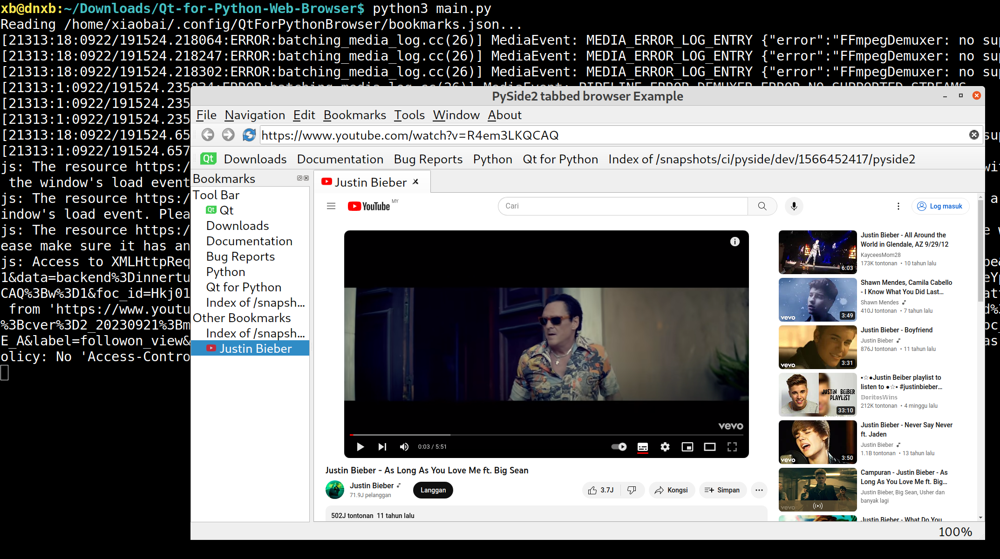

# Qt-for-Python-Web-Browser
Tabbed web browser in Qt for Python (PySide6), based on the official Qt for Python Web Browser example.

### Why?
The original PySide2 Web Browser example in the official tutorial at https://doc.qt.io/qtforpython-5/examples/tabbedbrowser.html is not able to run because of missing files. I replaced the file from other sources (e.g. webengineview.py is only found on pastebin, https://pastebin.com/DPWTWhFa , lol this import is custom file and has nothing to do with apt/pip packages!). I also fixed the [doc] syntax error and updated QWebXXX to QWebEngineXXX as stated at https://doc.qt.io/archives/qt-5.6/qtwebenginewidgets-qtwebkitportingguide.html , etc.

In 2026 it was ported from PySide2 to PySide6, because Qt WebEngine 5.13 shows blank pages on current Linux (glibc 2.34+).

#### Requirement:
    python3 -m venv .venv
    .venv/bin/pip install -r requirements.txt

Uses PySide6 6.12 (Qt WebEngine 6.140, Chromium 140).
Qt 6.5+ needs `libxcb-cursor0` on X11 (`sudo apt install libxcb-cursor0`).
 
#### Usage
    .venv/bin/python main.py

#### Screenshot:

  
